# 简介
该节点可以在 ComfyUI 中使用各种主流商业模型绘图节点，目前后端是使用**云雾 API** 提供的 API 支持。可以通过这个链接进行注册和使用：[https://www.cocode.icu/](https://www.cocode.icu/)

## 项目关注度

[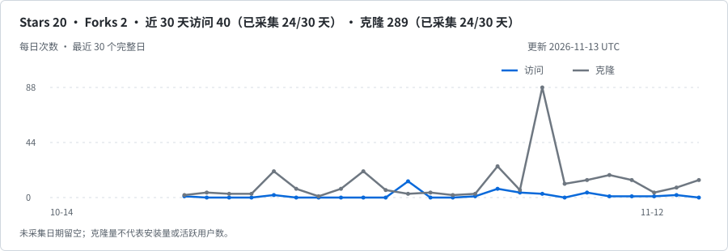](https://github.com/jiaqianjing/ComfyUI-MidjourneyHub/blob/metrics/latest.md)

[完整趋势报告](https://github.com/jiaqianjing/ComfyUI-MidjourneyHub/blob/metrics/latest.md) · [历史周报](https://github.com/jiaqianjing/ComfyUI-MidjourneyHub/tree/metrics/weekly) · [自动采集状态](https://github.com/jiaqianjing/ComfyUI-MidjourneyHub/actions/workflows/github-metrics.yml)

每天北京时间 09:17 自动更新（调度和图片缓存可能延迟），每周一归档周报。趋势图展示最近 30 天，未采集日期留空；按 UTC 完整日统计，克隆量不代表实际用户数。Star 曲线根据当前仍在关注的用户的加星日期绘制，不包含已经取消的 Star。

## 更新
* 2026.05.03 更新 openai **[GPT Image Generate]** 和 **[GPT Image Edit]** 节点，新增 `gpt-image-2-all` 模型支持（默认模型）
* 2026.01.22 更新 openai **[GPT Image Edit]** 节点，使用 Openai 最新的绘图模型 `gpt-image-1.5` 
* 2026.01.22 更新 openai **[GPT Image Generate]** 节点，使用 Openai 最新的绘图模型 `gpt-image-1.5` 
* 2026.01.22 新增 Google **[Gemini Image Generate]** 节点，使用 Gemini 3 Pro Image Preview 模型根据提示词生图;
* 2026.01.22 新增 Google **[Gemini Image Edit]** 节点，使用 Gemini 3 Pro Image Preview 模型根据提示词和参考图片进行编辑;
* 2025.06.18 新增 openai **[GPT Image Edit]** 节点，使用 Openai 最新的绘图模型 `gpt-image-1` 根据提示词和待修改的图片进行编辑;
* 2025.06.18 新增 openai **[GPT Image Generate]** 节点，使用 Openai 最新的绘图模型 `gpt-image-1` 根据提示词绘图;
* 2025.06.18 新增 midjourney **[Midjourney Blend (Image Mix)]** 节点，可上传两张图进行融合，支持 `seed` 避免缓存;
* 2024.12.13 引入协程的方式改造原始同步方法，通过并发加快创建图片和同步状态的响应尤其是 [Batch Upsale/Variation] 节点;
* 2024.12.10 支持 midjourney **[Midjourney Batch Upscale/Variation]** 节点;
* 2024.12.06 支持 midjourney **[MidjourneyImagineNode] 和 [Midjourney Upscale/Variation]** 节点;

## 使用方法
### 1. 修改自己的 api_url/api_key
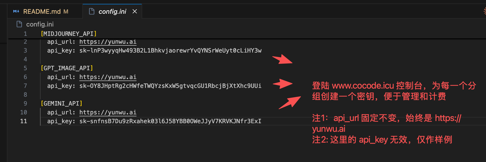
* [注]：因为后端 API 使用的云雾 API，他们可能不定期修改域名（api_url）

### 2. 工作流示例
1. **MidjourneyImagineNode** 节点 + **Midjourney Upscale/Variation** 节点
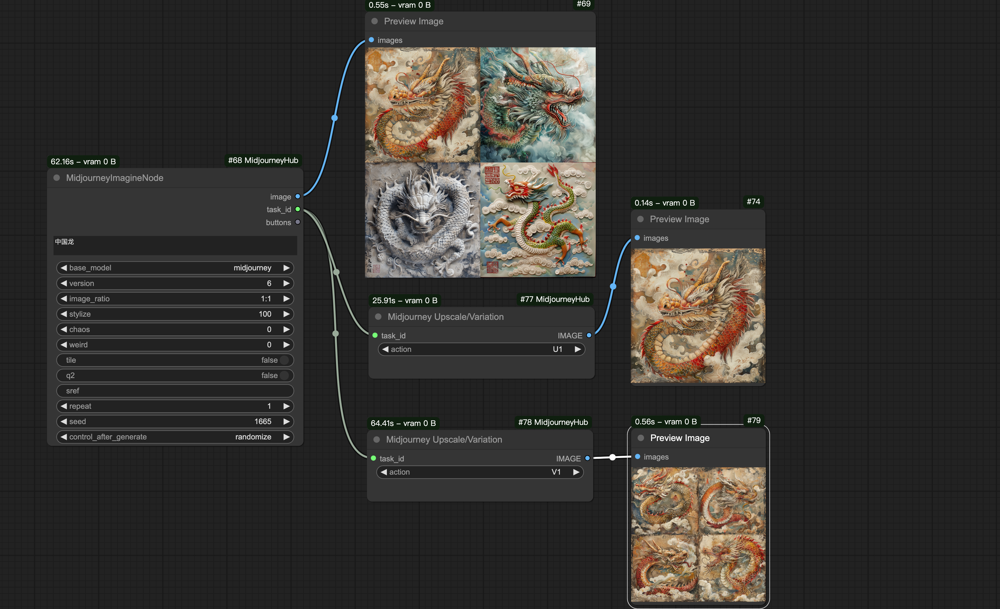

2. **MidjourneyImagineNode** 节点 + **Midjourney Batch Upscale/Variation** 节点
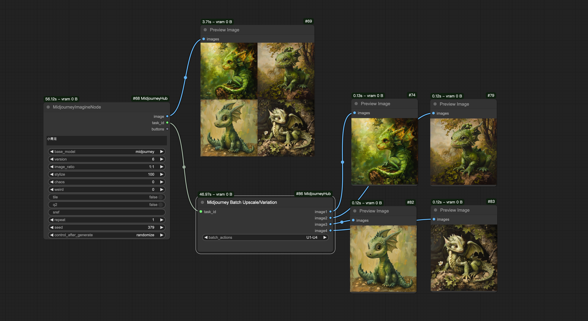

3. **Midjourney Blend (Image Mix)** 节点（两张图片融合）
    
    示例1:
    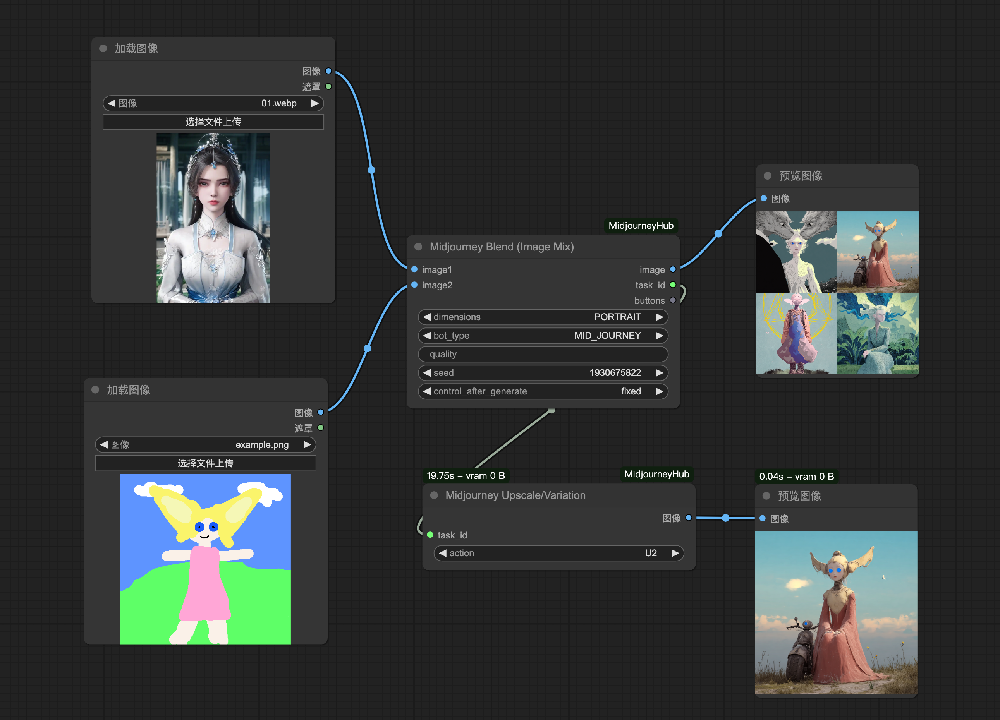

    示例2:
    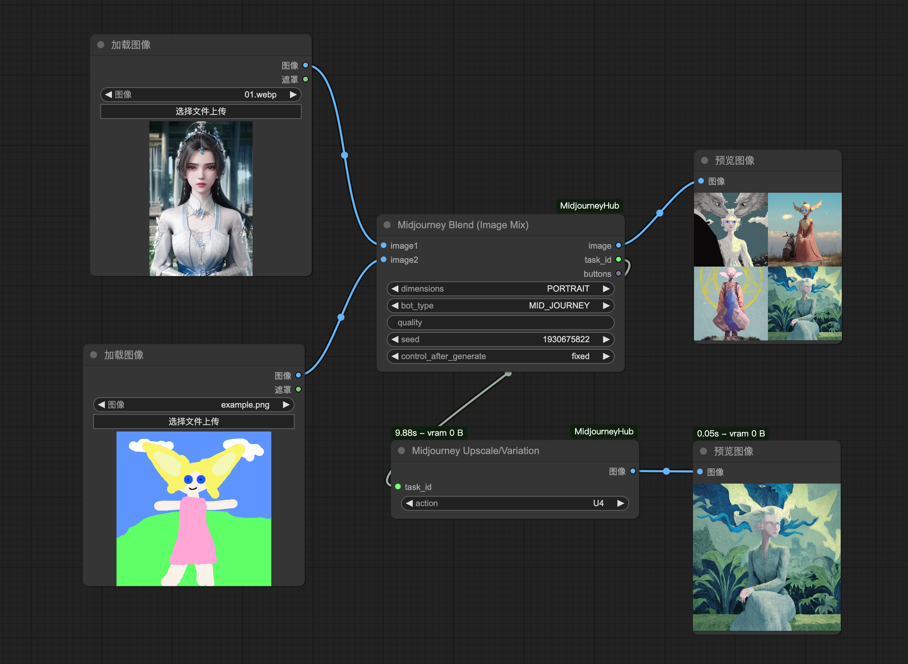

4. **GPT Image Generate** 节点生图（openai 最新的 SOTA 生图模型）
    示例:
    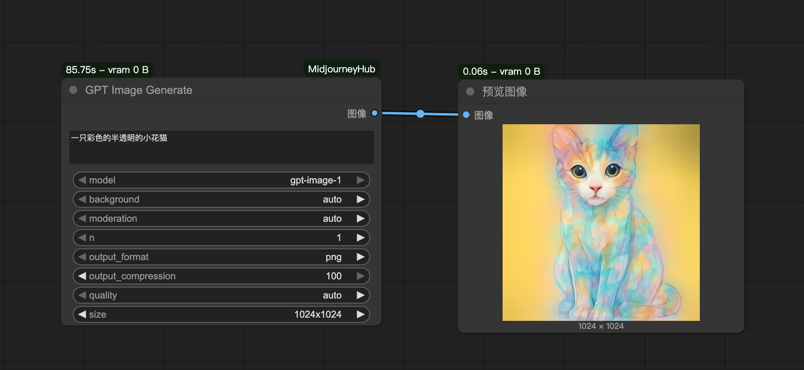

5. **GPT Image Edit** 节点编辑图（openai 最新的 SOTA 生图模型）
    示例:
    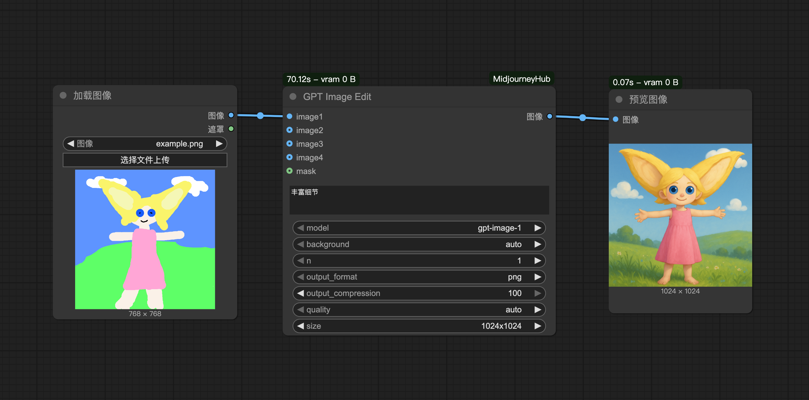

6. **Gemini Image Generate** 节点生图（Google Gemini 3 Pro Image Preview 模型）
    示例：
    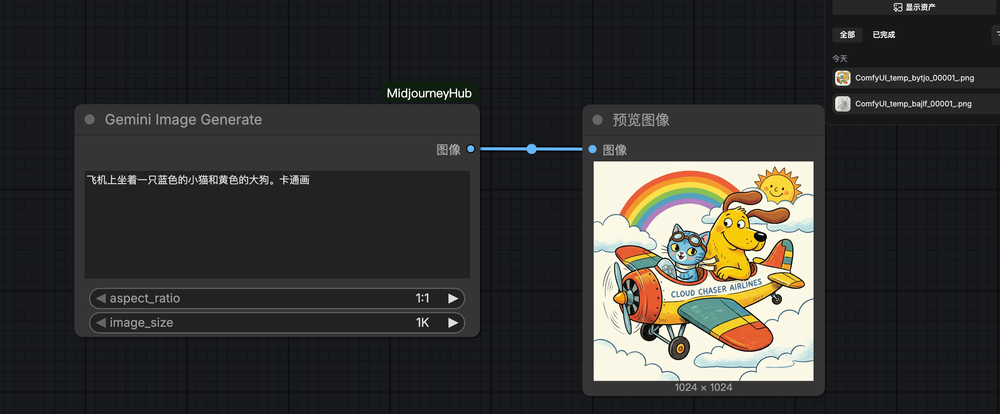

7. **Gemini Image Edit** 节点编辑图（Google Gemini 3 Pro Image Preview 模型）
    示例：
    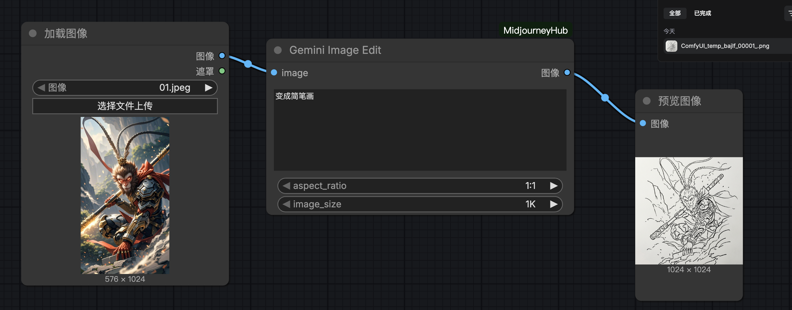

## Troubleshooting
1. 如何创建正确的分组 API 令牌（api_key）? 
使用云雾API时，需要创建对应的 API 令牌（也就是 config.ini 的 api_key），API 令牌还有分组的概念，不同的组能调用模型的范围不同对应的价格也不同（倍率），具体可以通过这个链接查询：https://yunwu.ai/pricing 以 `gpt-image-1` 为例，目前仅支持 `纯AZ`、`官转`、`官转OpenAI`、`优质官转OpenAI`:
    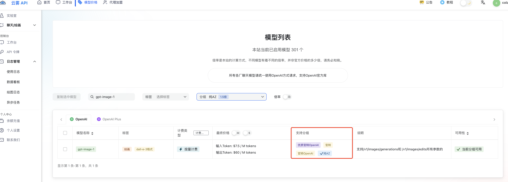

2. 遇到以下报错信息：“当前分组 纯AZ 下对于模型 gpt-image-1 无可用渠道”。
建议更换倍率更高的组，比如 `官转` 或者 `官转OpenAI`，保证稳定性（花费更多）

3. 如何查看费用使用情况？
使用云雾API时，可以通过【网页控制台】--【日志管理】--【使用日志】入口查看作业消耗的费用和时间等信息:
    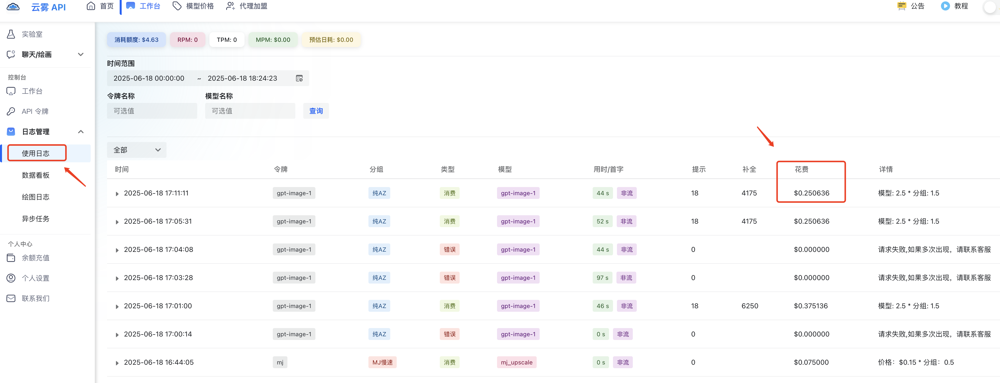

## 特别鸣谢
1. [ComfyUI-MidjourneyNode-leoleexh](https://github.com/leoleelxh/ComfyUI-MidjourneyNode-leoleexh/tree/main) 提供了节点的布局和样式借鉴，感谢作者的贡献！

## 📩 Disclaimer | 免责申明

本工具仅供学习和研究使用，使用本工具所产生的任何后果由用户自行承担。  

This tool is only for learning and research purposes, and any consequences arising from the use of this tool are borne
by the user.

## 💰 Buy Me a Coffee | 请我喝杯咖啡

  <table>
    <tr>
      <td>
         
      </td>
      <td>
         
      </td>
    </tr>
  </table>

